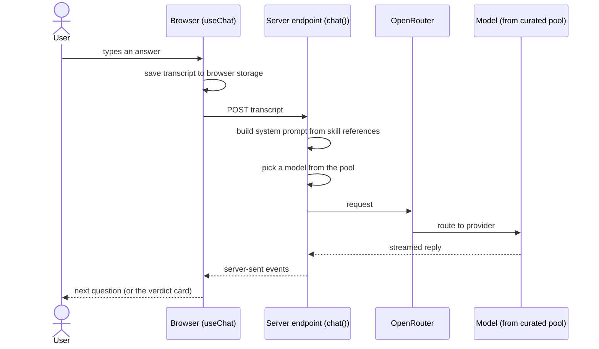
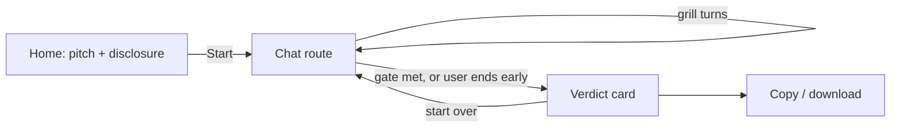
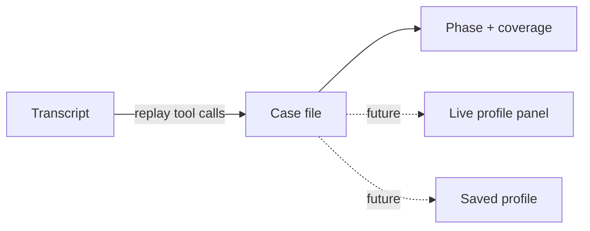
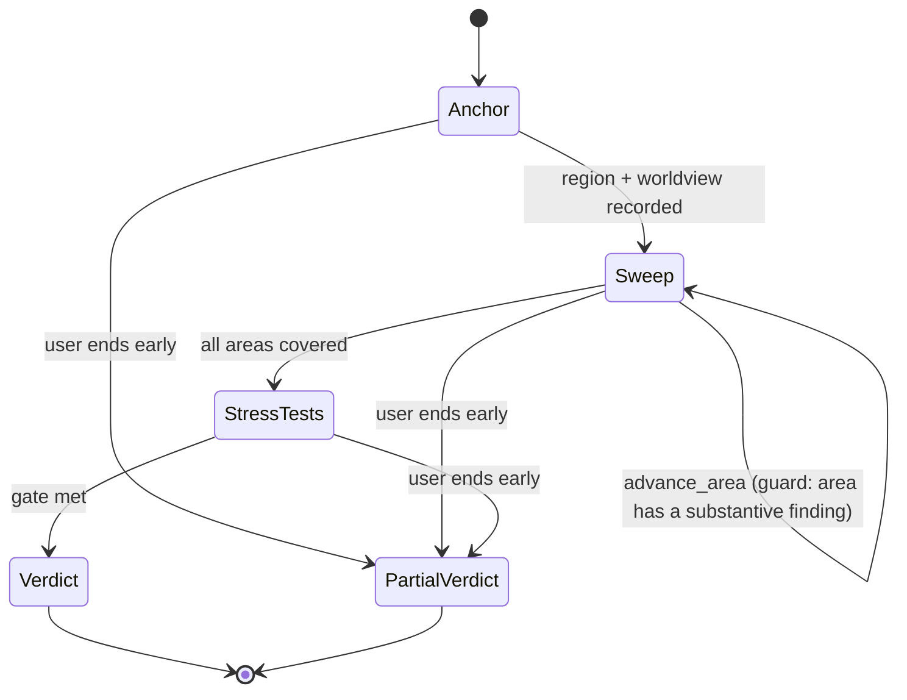

# Architecture

How the Polytic Party chat works. The first part describes **v1 as decided**
(`docs/adrs/`). The second part records **direction under consideration**: ideas we
expect to need, written down so the thinking isn't lost, but **not committed and not
built**. Terms are defined in `glossary.md`.

## v1: a simple chat

One chat route in the TanStack Start app (`apps/web`), one server endpoint, one system
prompt. TanStack AI handles the chat loop on the server (`chat()` streamed back as
server-sent events) and the client (`useChat`). The transcript is persisted in the
browser only (ADR-0004).

- **System prompt.** Assembled from the skill's protocol, taxonomy, and label references,
  which are the framework's source of truth (ADR-0005). The grill follows the same
  protocol as the skill: anchor, skeleton sweep, stress-tests, then the verdict gate.
- **Models.** A curated pool of free and very cheap reasoning models via OpenRouter, with
  automatic selection from the pool (ADR-0003).
- **Verdict.** Delivered as the final chat message in the skill's verdict format, rendered
  as a distinct card with copy and download (ADR-0001).
- **Storage.** None on our servers. The browser holds the session.

### Session lifecycle (v1)

### Open items for v1

- **Rate limiting and abuse control** for a login-free public chat. Undecided. Candidates
  include a bot check at session start, per-IP limits, and per-session turn/token caps.
- **Suggested answers.** v1 is free text only. How (and whether) to offer predetermined
  answers without turning the grill into a quiz is open.

## Direction under consideration

None of this is decided. It is the shape we currently expect the chat to grow into, kept
here so later decisions can accept, change, or reject it explicitly (with an ADR).

### The case file: notes recorded as tool calls

Long sessions are the biggest risk: models forget and drop the thread. The idea: after
each answer, the interviewer records what it learned through tools (`record_finding`,
`flag_tension`, …). Those tool calls live in the transcript, so **the notes are the
transcript**. Replaying them rebuilds a **case file** (findings, tensions, open topics,
coverage) without any database, which fits browser-only storage. A future live profile
panel and saved profiles would display the same case file.

What a finding contains depends on the framework theory (`framework.md`).

### Code enforces structure, the model does the talking

Prompt-only rules ("at least 20 answers, every area visited") are what cheap models
break. The idea: a small state machine, computed from the case file by the same shared
code in browser and server, decides the phase and which tools the model can see. The
model **proposes** transitions through control tools; **guards in code decide**. The
verdict tool doesn't exist until the coverage gate is met.

### Tool groups

A fixed set of groups so the toolset can grow without becoming a flat pile. Each tool
declares its group, whether it reads or writes, and which phases it's available in.

| Group     | Purpose                                                 | When     |
| --------- | ------------------------------------------------------- | -------- |
| Record    | Write to the case file (findings, tensions, coverage)   | Proposed |
| Reference | Read framework material on demand (dimensions, labels)  | Proposed |
| Control   | Move between phases, end early, the gated verdict       | Proposed |
| Profile   | Read a logged-in user's saved profile and past sessions | Future   |
| Community | Discussions, summaries across users, formal debates     | Future   |

### Verdict: same thread or its own call

Whether the verdict is written by the interviewer in the same thread or by a separate
call (possibly a stronger model) over the transcript and case file is **open**. A single
thread can likely do it once the gate is enforced. Either way the verdict is a distinct,
gated step, so switching later is cheap. v1 uses the same thread.

### Privacy mode

A user-selectable mode that restricts model selection to providers that don't train on
or retain prompts (ADR-0004).
